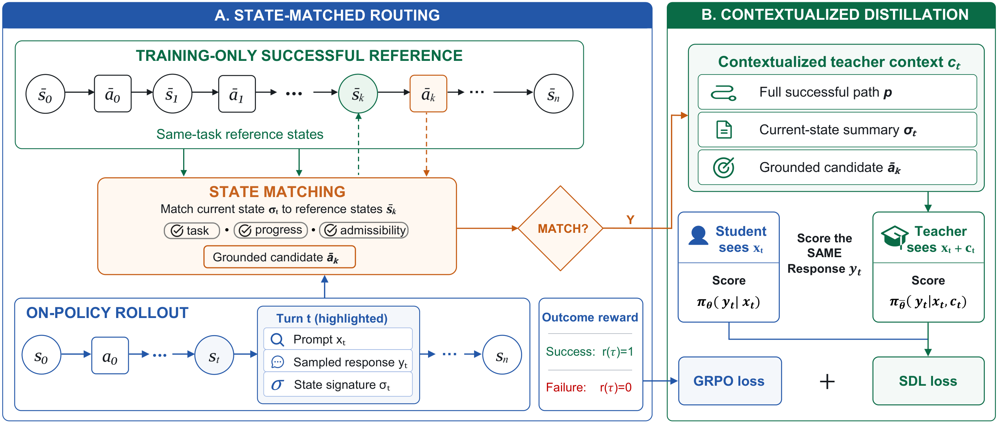
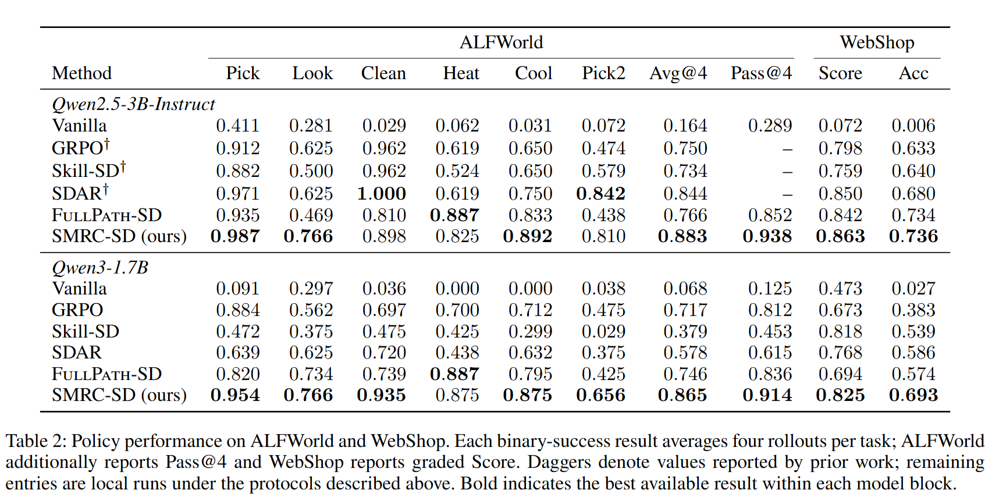

# SMRC-SD

   

Code for *When Privileged Guidance Misaligns: State-Matched Routing and Contextualized Self-Distillation for Multi-Turn Agents*, including **SMRC-SD** and the **FullPath-SD** baseline.



SMRC-SD uses successful trajectories as training-only guidance for on-policy agents. It is evaluated on ALFWorld and WebShop with Qwen3-1.7B and Qwen2.5-3B models.

## Overview

Successful trajectories are useful references, but a student can reach a different state after an exploratory action or a reordered subgoal. A task-correct reference can therefore be locally incompatible with the state currently reached. We call this **state--reference mismatch**.

SMRC-SD addresses both where and how a successful reference is used:

- **State-matched routing:** reconstruct compact state signatures from the successful path and apply self-distillation only when the reached state has a compatible reference position and an admissible continuation.
- **Contextualized guidance:** on supported turns, condition the synchronized teacher on the full successful path, a current-state summary, and a grounded candidate next action.
- **On-policy learning remains intact:** GRPO optimizes every trajectory; unsupported turns simply receive no reference-conditioned self-distillation loss.
- **Training-only privilege:** the matcher, reference path, state summary, and candidate action are removed at inference time.

With Qwen3-1.7B, SMRC-SD improves over unconditional FullPath-SD from 0.746 to 0.865 task success on ALFWorld and from 0.574 to 0.693 on WebShop under the paper's evaluation protocol.



## Contents


| Path                                | Description                                                               |
| ----------------------------------- | ------------------------------------------------------------------------- |
| `examples/smrc_sd/`                 | Paper training / probe launchers                                          |
| `examples/smrc_sd/data/`            | GT reference paths (ALFWorld walkthrough index, WebShop oracle manifests) |
| `examples/smrc_sd/probe/`           | Fixed-anchor teacher intervention probe (paper mechanism study)           |
| `assets/smrc_sd_overview.png`       | Method overview used above                                                |
| `assets/table2.png`                 | ALFWorld / WebShop results table used above                               |
| `verl/`, `agent_system/`, `skills/` | Training framework, env managers, skill files                             |
| `scripts/model_merger.py`           | Merge FSDP actor shards to HuggingFace format (used by the probe)         |


## 1. Environment setup


### 1.1 ALFWorld (Python 3.12; recommended vLLM 0.17 veRL image)

The ALFWorld results were run in a Python 3.12 environment with vLLM 0.17. For the closest reproduction, start from a veRL container image built for vLLM 0.17 and install this repository in editable mode inside it. This avoids resolving PyTorch, CUDA, FlashAttention, and vLLM independently. The image must expose the GPUs and provide a CUDA/PyTorch build compatible with its vLLM 0.17 installation.

For a local installation, create a separate environment; do not reuse the WebShop environment below.

```bash
conda create -n smrc-sd python==3.12 -y
conda activate smrc-sd

# The ALFWorld launchers use the vLLM backend. Pin the stack used for the current ALFWorld runs rather than the older vLLM 0.11 stack.
pip install vllm==0.17.0
pip install flash-attn==2.7.4.post1 --no-build-isolation --no-cache-dir
pip install -e .

pip install gymnasium==0.29.1 stable-baselines3==2.6.0 alfworld
alfworld-download -f
```

Point the trainer at your local ALFWorld data (default expects a repo-relative copy):

```bash
export ALFWORLD_DATA=/path/to/alfworld   # contains json_2.1.1/
# optional: symlink into the repo
mkdir -p data/raw && ln -s "$ALFWORLD_DATA" data/raw/alfworld
```

Download base models (or set `MODEL_PATH` to a local folder):

```bash
# defaults used by the launchers
# Qwen/Qwen3-1.7B
# Qwen/Qwen2.5-3B-Instruct
```


### 1.2 WebShop (separate Python 3.10 environment)

WebShop has an independent, pinned stack. In particular, the released WebShop launchers were validated with vLLM 0.8.5, Ray 2.43.0, and OpenTelemetry 1.26; do **not** install vLLM 0.17 or reuse the Python 3.12 ALFWorld environment for WebShop.

```bash
conda create -n verl-agent-webshop -c conda-forge --override-channels \
  python==3.10 openjdk=11 faiss-cpu mkl=2025.3.1 pip -y
conda activate verl-agent-webshop

# Install the 1,000-product text-only subset used by the release scripts.
cd agent_system/environments/env_package/webshop/webshop
bash setup.sh -d small

# Return to the repository root and install the validated GPU/runtime stack.
cd ../../../../..
python -m pip install torch==2.6.0 --index-url https://download.pytorch.org/whl/cu124
python -m pip install flash-attn==2.7.4.post1 --no-build-isolation
python -m pip install -e .
python -m pip install vllm==0.8.5 \
  numpy==1.26.4 opencv-python-headless==4.11.0.86 \
  typer==0.9.4 click==8.2.1 websockets==11.0.3 cupy-cuda12x==13.3.0 \
  google-api-core==2.24.2 protobuf==4.25.9 \
  'ray[default,cgraph]==2.43.0' \
  opentelemetry-api==1.26.0 opentelemetry-sdk==1.26.0 \
  opentelemetry-exporter-otlp==1.26.0 \
  opentelemetry-exporter-prometheus==0.47b0
python -m pip uninstall -y fastapi-cli fastapi-cloud-cli decord
python -m pip check
```

`setup.sh` persists the JVM variables used by PyJNIus. Reactivate the conda environment once after it finishes. Keep `mkl=2025.3.1`: the current FAISS build requires its ABI. Do not upgrade Ray alone to 2.49/2.50, because its dashboard metrics path conflicts with vLLM 0.8.5's OpenTelemetry constraint.

Before a training run, a minimal dependency check is:

```bash
python -c "import torch, vllm, flash_attn, faiss, ray; print(torch.__version__, vllm.__version__, flash_attn.__version__, faiss.__version__, ray.__version__)"
python -m pip check
```

The WebShop launchers call `examples/smrc_sd/run_trainer_webshop.sh`. To make the interpreter selection explicit, especially when launching from another shell, set:

```bash
export CONDA_BIN="$(command -v conda)"
export CONDA_ENV=verl-agent-webshop
```

If `verl-agent-webshop` is already active, the wrapper runs it directly; otherwise it re-enters this environment through `conda run`.

### 1.3 Reference data (included)

Already shipped under `examples/smrc_sd/data/`:

- `alfworld_verified_walkthrough_prefixes.jsonl` — ALFWorld GT path index for FullPath-SD / SMRC-SD
- `alfworld_verified_walkthrough_trajectories.jsonl` — full verified walkthrough trajectories
- `webshop_small_seed0_oracle_paths.jsonl` — WebShop oracle paths
- `webshop_small_seed0_val128.json` — fixed 128-task WebShop validation manifest

ALFWorld gamefile keys are stored as `json_2.1.1/...` suffixes and relocated via `ALFWORLD_DATA`.

## 2. Running experiments

All launchers live in `examples/smrc_sd/`. Override GPUs / model path as needed:

```bash
export CUDA_VISIBLE_DEVICES=0,1,2,3
export N_GPUS_PER_NODE=4
export MODEL_PATH=/path/to/Qwen3-1.7B   # optional local override
```


### 2.1 Main methods (8 scripts)

Paper checkpoints: **Qwen3 ALFWorld = 250 updates**; **Qwen2.5 (both) and WebShop = 150 updates**. Validation uses 128 fixed tasks × 4 rollouts.


| Method      | Env      | Model      | Script                                                         |
| ----------- | -------- | ---------- | -------------------------------------------------------------- |
| FullPath-SD | ALFWorld | Qwen3-1.7B | `bash examples/smrc_sd/run_fullpath_sd_alfworld_qwen3_1p7b.sh` |
| SMRC-SD     | ALFWorld | Qwen3-1.7B | `bash examples/smrc_sd/run_smrc_sd_alfworld_qwen3_1p7b.sh`     |
| FullPath-SD | ALFWorld | Qwen2.5-3B | `bash examples/smrc_sd/run_fullpath_sd_alfworld_qwen2p5_3b.sh` |
| SMRC-SD     | ALFWorld | Qwen2.5-3B | `bash examples/smrc_sd/run_smrc_sd_alfworld_qwen2p5_3b.sh`     |
| FullPath-SD | WebShop  | Qwen3-1.7B | `bash examples/smrc_sd/run_fullpath_sd_webshop_qwen3_1p7b.sh`  |
| SMRC-SD     | WebShop  | Qwen3-1.7B | `bash examples/smrc_sd/run_smrc_sd_webshop_qwen3_1p7b.sh`      |
| FullPath-SD | WebShop  | Qwen2.5-3B | `bash examples/smrc_sd/run_fullpath_sd_webshop_qwen2p5_3b.sh`  |
| SMRC-SD     | WebShop  | Qwen2.5-3B | `bash examples/smrc_sd/run_smrc_sd_webshop_qwen2p5_3b.sh`      |


**FullPath-SD**: privileged complete successful path on every turn (`PATH_TEACHER_CONTEXT=gt_path`, SDL on all turns).

**SMRC-SD**: structured-state (ALFWorld) / goal-progress (WebShop) matcher; SDL only on matched turns; teacher context = full path + current-state summary + candidate next action with `path_on_or_off` guidance.

### 2.2 Qwen3-1.7B ALFWorld baselines

```bash
bash examples/smrc_sd/run_grpo_alfworld_qwen3_1p7b.sh      # GRPO
bash examples/smrc_sd/run_skill_sd_alfworld_qwen3_1p7b.sh  # Skill-SD
bash examples/smrc_sd/run_sdar_alfworld_qwen3_1p7b.sh      # SDAR (skill teacher + gated loss)
```


### 2.3 Fixed-anchor teacher probe

After a GRPO run has written rollouts at updates 5/100/150/200/250 and a `global_step_250` actor checkpoint:

```bash
export GRPO_ROLLOUT_DIR=logs/smrc_sd_alfworld/rollouts/grpo_alfworld_qwen3_1p7b
export GRPO250_ACTOR=checkpoints/smrc_sd_alfworld/grpo_alfworld_qwen3_1p7b/global_step_250/actor
bash examples/smrc_sd/probe/run_anchor_probe.sh
```

This builds the 1,200-anchor suite (400 each of strata A/B/C) and scores FullPath / SMRC interventions with the base model and the GRPO-250 scorer.

### 2.4 Common overrides

```bash
LOGGER="['console']"                 # default; add wandb/swanlab if desired
TOTAL_TRAINING_STEPS=150             # paper WebShop / Qwen2.5 horizon
SAVE_FREQ=25
PATH_OPD_SUITE_DIR=logs/my_run       # logs, rollouts, validation dumps
PROCESSED_DATA_DIR=/tmp/smrc_data    # optional: keep generated parquet outside the repo
ENV_SEED=0                           # default seed used for the reported runs
EXPERIMENT_NAME=smrc_sd_run          # optional run label; defaults are method/model specific
VERBOSE_LAUNCH=1                     # optional: print the full launcher command
VERBOSE_CONFIG=1                     # optional: print the resolved trainer configuration
```


## 3. Reproducibility and validation protocol

This implementation is based on the SDAR / veRL-agent codebase. In the upstream SDAR evaluation flow, validation tasks are selected by a seeded random process: re-running with the same seed is reproducible, but changing the seed can select a different validation-task set. **We make the validation contract explicit instead**. ALFWorld always evaluates the **same fixed 128-task list** with **four rollouts per task** (512 trajectories), and WebShop uses the included fixed validation manifest under the same four-rollout protocol. Consequently, `val@4` is computed on identical tasks across methods, checkpoints, and seeds; logs report `unique_items=128`, `unique_games=128`, and `sample_index_max=3` as an integrity check.

The included SDAR and Skill-SD launchers are therefore **local reproductions under this validation protocol**. Their results **can differ from the original SDAR paper** or released scripts even when optimization settings are otherwise comparable. In particular, under our local reproduction protocol we also observed GRPO outperforming SDAR in the corresponding comparison. This is consistent with a community WebShop reproduction report for Qwen2.5-3B ([SDAR issue #43](https://github.com/ZJU-REAL/SDAR/issues/43)); it should not be interpreted as a claim that GRPO universally dominates SDAR across all implementation and evaluation settings. Together with the validation-task sensitivity discussed in [issue #52](https://github.com/ZJU-REAL/SDAR/issues/52), these reports motivate recording the model, environment stack, validation manifest, seed, and training horizon whenever comparing results. The scripts in this release fix the validation manifest and `val@4` aggregation; they do not claim to exactly reproduce every number reported by the original SDAR release.

## 4. Method summary

SMRC-SD at each turn:

1. Matches the student’s execution state against the successful reference path.
2. If matched, builds privileged teacher context: complete path + one-line state summary + admissible candidate action.
3. Applies chosen-token SDL only on matched turns; GRPO remains active on all turns.
4. At inference, removes the teacher, matcher, and privileged fields.


## Acknowledgements

This codebase is built on [SDAR](https://github.com/ZJU-REAL/SDAR) and its veRL-agent stack, and includes components from [veRL](https://github.com/volcengine/verl). The on-policy self-distillation formulation is also informed by [SDPO](https://arxiv.org/abs/2601.20802). We thank the respective authors and contributors for making their work available.

## License

Apache-2.0. See `LICENSE` and `Notice.txt` for upstream attributions.