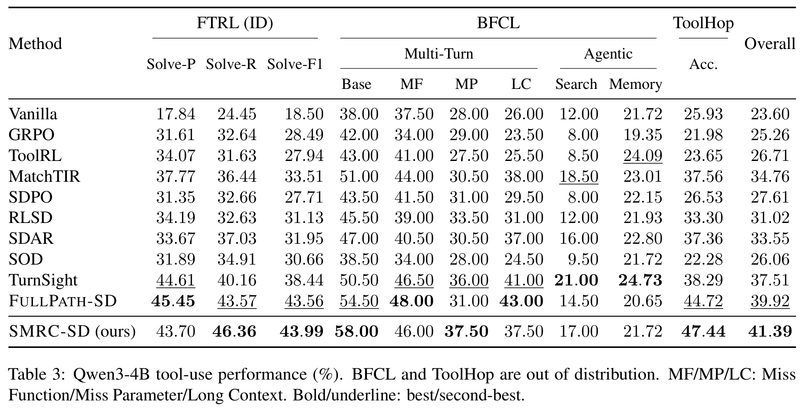

# SMRC-SD: State-Matched Routing and Contextualized Self-Distillation for Multi-Turn Agents

Code for *When Privileged Guidance Misaligns: State-Matched Routing and Contextualized Self-Distillation for Multi-Turn Agents*.

**Use successful references where they apply.** SMRC-SD matches the student's reached state to a reference continuation, then uses the reference to guide self-distillation on compatible turns. The resulting policy runs without references, a teacher, or a matcher at inference.

[Method](#overview) · [Results](#results) · [Setup](#1-environment-setup) · [Training](#2-running-experiments) · [Evaluation](#3-evaluation-protocol)

## Overview

A successful reference can become locally incompatible when an agent explores a different action or completes subgoals in another order. **State–reference mismatch** makes unconditional reference guidance unreliable.


*State matching decides when to distill; reached-state context tells the teacher how to guide the student.*

1. **Match the reached state.** Extract task-relevant facts and find a compatible reference position with an admissible continuation.
2. **Contextualize the reference.** Give the synchronized teacher the full reference, a current-state summary, and a compatible next action or action set.
3. **Distill on matched turns.** Re-score the student's own response with the teacher. Unmatched turns receive no reference-conditioned SDL; GRPO still trains on every trajectory.

Both methods below use the same on-policy GRPO + chosen-token self-distillation framework:


| Method          | Turns receiving SDL               | Teacher context                                             |
| --------------- | --------------------------------- | ----------------------------------------------------------- |
| **FullPath-SD** | All turns with a usable reference | Full reference path                                         |
| **SMRC-SD**     | State-matched turns               | Full path + reached-state summary + compatible continuation |


### Supported environments


| Environment  | Interaction                 | State representation                                      | Models                               |
| ------------ | --------------------------- | --------------------------------------------------------- | ------------------------------------ |
| **ALFWorld** | Embodied tasks              | Location, inventory, task-object locations and properties | Qwen3-1.7B / 4B, Qwen2.5-3B-Instruct |
| **WebShop**  | Product search and purchase | Page type, current product, selected options              | Qwen3-1.7B / 4B, Qwen2.5-3B-Instruct |
| **FTRL**     | Tool use                    | Observed tool calls and canonicalized returns             | Qwen3-4B                             |


## Results

**Table 2. ALFWorld and WebShop performance.** The full comparison across Qwen2.5-3B-Instruct, Qwen3-1.7B, and Qwen3-4B.


**FTRL and out-of-domain tool-use results (Table 3)**



## 1. Environment setup


### 1.1 Training environment and ALFWorld

Use a Python 3.12 training environment with vLLM 0.17, or start from a compatible veRL container and install this repository in editable mode. This avoids resolving PyTorch, CUDA, FlashAttention, and vLLM independently. The image must expose the GPUs and provide a CUDA/PyTorch build compatible with its vLLM 0.17 installation.

For a local installation, create a separate environment.

```bash
conda create -n smrc-sd python==3.12 -y
conda activate smrc-sd

# GPU training stack
pip install vllm==0.17.0
pip install flash-attn==2.7.4.post1 --no-build-isolation --no-cache-dir
pip install -e .

pip install gymnasium==0.29.1 stable-baselines3==2.6.0 alfworld
alfworld-download -f
```

Point the trainer at your local ALFWorld data (default expects a repo-relative copy):

```bash
export ALFWORLD_DATA=/path/to/alfworld   # contains json_2.1.1/
# optional: symlink into the repo
mkdir -p data/raw && ln -s "$ALFWORLD_DATA" data/raw/alfworld
```

Download base models (or set `MODEL_PATH` to a local folder):

```bash
# defaults used by the launchers
# Qwen/Qwen2.5-3B-Instruct
# Qwen/Qwen3-1.7B
# Qwen/Qwen3-4B
```


### 1.2 WebShop

All WebShop launchers use a separate **CPU simulator service**. GPU training reuses the environment from section 1.1; no additional vLLM installation is needed.

Create the simulator environment and download the small 1,000-product catalog:

```bash
conda create -n webshop-cpu -c conda-forge --override-channels \
  python=3.10 openjdk=11 faiss-cpu mkl=2025.3.1 pip -y
conda activate webshop-cpu
python -m pip install torch==2.6.0 --index-url https://download.pytorch.org/whl/cpu
python -m pip install omegaconf==2.3.0

cd agent_system/environments/env_package/webshop/webshop
bash setup.sh -d small
cd ../../../../..

# Reactivate to load the JVM settings written by setup.sh.
conda deactivate
conda activate webshop-cpu
export WEBSHOP_CPU_PYTHON="$CONDA_PREFIX/bin/python"
export WEBSHOP_DATA_DIR="$PWD/agent_system/environments/env_package/webshop/webshop/data"
```

Return to the GPU training environment and start the CPU services:

```bash
conda activate smrc-sd
bash examples/smrc_sd/start_webshop_cpu_service.sh
export WEBSHOP_SERVICE_FILE="$PWD/logs/webshop_cpu_services.json"
```

The same service supports Qwen3-1.7B, Qwen2.5-3B, and Qwen3-4B. It runs in the background; logs are saved under `logs/webshop_cpu/`.

### 1.3 FTRL

[FTRL](https://aclanthology.org/2026.findings-acl.109/) uses a lightweight CPU service to execute tools and score trajectories. Training reuses the GPU environment from section 1.1.

From the repository root, with `smrc-sd` active, create the tool environment:

```bash
conda create -n ftrl-cpu python=3.10 pip -y
conda run -n ftrl-cpu python -m pip install \
  numpy==1.26.4 omegaconf==2.3.0 python-dateutil==2.9.0.post0 \
  six==1.17.0 pytz==2025.2 dicttoxml==1.7.16
```

Download the 2,215/200 train/test split from [TurnSight's Data directory](https://github.com/quchangle1/TurnSight/tree/main/Data), then convert it in the GPU training environment:

```bash
export FTRL_ROOT=/path/to/ftrl_assets
mkdir -p "$FTRL_ROOT/upstream"
# Place train.parquet and test.parquet in $FTRL_ROOT/upstream/.
python scripts/prepare_ftrl_smrc.py --root "$FTRL_ROOT"
```

Start the CPU service in a **second terminal**, leaving it running:

```bash
conda run --no-capture-output -n ftrl-cpu \
  python -m agent_system.environments.env_package.ftrl.service \
  --root /path/to/ftrl_assets --port 28980
```

Back in the training terminal, prepare the references:

```bash
python scripts/prepare_ftrl_smrc.py --root "$FTRL_ROOT" --replay
cp "$FTRL_ROOT/references.jsonl" "$FTRL_ROOT/references_state_checked.jsonl"
python scripts/prepare_ftrl_normalized_states.py \
  --root "$FTRL_ROOT" --output "$FTRL_ROOT/normalized"
```


### 1.4 Included references

Already shipped under `examples/smrc_sd/data/`:

- `alfworld_verified_walkthrough_prefixes.jsonl` — ALFWorld GT path index for FullPath-SD / SMRC-SD
- `alfworld_verified_walkthrough_trajectories.jsonl` — full verified walkthrough trajectories
- `webshop_small_seed0_oracle_paths.jsonl` — WebShop oracle paths
- `webshop_small_seed0_val128.json` — fixed 128-task WebShop validation manifest

ALFWorld gamefile keys are stored as `json_2.1.1/...` suffixes and relocated via `ALFWORLD_DATA`.

## 2. Running experiments

Run commands from the repository root in the GPU training environment. Each launcher selects its model and GPU defaults. Override them for a single run as needed:

```bash
CUDA_VISIBLE_DEVICES=0,1,2,3 N_GPUS_PER_NODE=4 MODEL_PATH=/path/to/Qwen3-4B \
  bash examples/smrc_sd/run_smrc_sd_alfworld_qwen3_4b.sh
```


### 2.1 ALFWorld

Qwen3-1.7B uses 250 updates and a 30-turn horizon; Qwen2.5-3B and Qwen3-4B use 150 updates and a 50-turn horizon. Choose a model and method:

```bash
# Qwen3-1.7B
bash examples/smrc_sd/run_smrc_sd_alfworld_qwen3_1p7b.sh
bash examples/smrc_sd/run_fullpath_sd_alfworld_qwen3_1p7b.sh

# Qwen2.5-3B-Instruct
bash examples/smrc_sd/run_smrc_sd_alfworld_qwen2p5_3b.sh
bash examples/smrc_sd/run_fullpath_sd_alfworld_qwen2p5_3b.sh

# Qwen3-4B
bash examples/smrc_sd/run_smrc_sd_alfworld_qwen3_4b.sh
bash examples/smrc_sd/run_fullpath_sd_alfworld_qwen3_4b.sh
```

Additional Qwen3-1.7B baselines:

```bash
bash examples/smrc_sd/run_grpo_alfworld_qwen3_1p7b.sh
bash examples/smrc_sd/run_skill_sd_alfworld_qwen3_1p7b.sh
bash examples/smrc_sd/run_sdar_alfworld_qwen3_1p7b.sh
```

Fixed-anchor teacher intervention probe

After a GRPO run has written rollouts at updates 5/100/150/200/250 and the final actor checkpoint:

```bash
export GRPO_ROLLOUT_DIR=logs/smrc_sd_alfworld/rollouts/grpo_alfworld_qwen3_1p7b
export GRPO250_ACTOR=checkpoints/smrc_sd_alfworld/grpo_alfworld_qwen3_1p7b/global_step_250/actor
bash examples/smrc_sd/probe/run_anchor_probe.sh
```

This builds and scores the 1,200-anchor suite. See the [probe guide](examples/smrc_sd/probe/README.md) for details.

### 2.2 WebShop

Start the CPU service in [section 1.2](#12-webshop). All models use 150 updates and a 15-turn horizon:

```bash
export WEBSHOP_SERVICE_FILE="$PWD/logs/webshop_cpu_services.json"

# Qwen3-1.7B
bash examples/smrc_sd/run_smrc_sd_webshop_qwen3_1p7b.sh
bash examples/smrc_sd/run_fullpath_sd_webshop_qwen3_1p7b.sh

# Qwen2.5-3B-Instruct
bash examples/smrc_sd/run_smrc_sd_webshop_qwen2p5_3b.sh
bash examples/smrc_sd/run_fullpath_sd_webshop_qwen2p5_3b.sh

# Qwen3-4B
bash examples/smrc_sd/run_smrc_sd_webshop_qwen3_4b.sh
bash examples/smrc_sd/run_fullpath_sd_webshop_qwen3_4b.sh
```


### 2.3 FTRL

Prepare the data and start the CPU service in [section 1.3](#13-ftrl). Both Qwen3-4B methods use 207 updates, 32 tasks per update, eight rollouts per task, and a 10-turn horizon:

```bash
export FTRL_ROOT=/path/to/ftrl_assets
bash examples/smrc_sd/run_smrc_sd_ftrl_qwen3_4b.sh
bash examples/smrc_sd/run_fullpath_sd_ftrl_qwen3_4b.sh
```

SMRC-SD uses exact state matching after literal default-argument normalization. Tasks without a usable reference still receive GRPO updates, with SDL disabled.

### 2.4 Common overrides

Pass environment variables before the launcher or Hydra overrides after it:

```bash
ENV_SEED=22 EXPERIMENT_NAME=my_run \
  bash examples/smrc_sd/run_smrc_sd_alfworld_qwen3_4b.sh \
  trainer.total_training_steps=150 trainer.save_freq=25
```

Use `MODEL_PATH` for local model weights, `N_GPUS_PER_NODE` and `CUDA_VISIBLE_DEVICES` for GPU allocation, and `PATH_OPD_SUITE_DIR` for logs and rollout outputs. Qwen3-4B launchers default to seed 0, use separate output directories per seed, and start from the base model.

## 3. Evaluation protocol


| Environment | Evaluation                             | Metrics                               |
| ----------- | -------------------------------------- | ------------------------------------- |
| ALFWorld    | 128 fixed held-out tasks × 4 attempts  | Avg@4; Pass@4 as an additional metric |
| WebShop     | Fixed 128-task manifest × 4 attempts   | Avg@4 and raw environment Score       |
| FTRL        | All 200 test tasks, one greedy attempt | Solve-P / Solve-R / Solve-F1          |


**Avg@4** averages the four attempts; **Pass@4** counts whether at least one succeeds. WebShop uses the small 1,000-product catalog with synthetic goals: goals 500–6909 are used for training, and validation is drawn from the first 500 goals. FTRL Solve-F1 measures acquisition of required tool information.

### In-domain evaluation

Training launchers validate before training, periodically, and at the final update. The same launchers support evaluation-only runs. First merge a trained FSDP actor into Hugging Face format:

```bash
python scripts/model_merger.py merge --backend fsdp \
  --local_dir /path/to/checkpoint/global_step_150/actor \
  --target_dir /path/to/merged_model
```

For FTRL, use `global_step_207/actor`. Then choose the corresponding dataset launcher and supply that model's merged weights:

```bash
# ALFWorld
MODEL_PATH=/path/to/merged_model bash examples/smrc_sd/run_smrc_sd_alfworld_qwen3_4b.sh \
  trainer.val_only=True trainer.val_before_train=True trainer.resume_mode=disable \
  trainer.validation_data_dir=logs/evaluation/alfworld

# WebShop: keep the CPU service running and WEBSHOP_SERVICE_FILE set.
MODEL_PATH=/path/to/merged_model bash examples/smrc_sd/run_smrc_sd_webshop_qwen3_4b.sh \
  trainer.val_only=True trainer.val_before_train=True trainer.resume_mode=disable \
  trainer.validation_data_dir=logs/evaluation/webshop

# FTRL: keep the CPU service running and FTRL_ROOT set.
MODEL_PATH=/path/to/merged_model bash examples/smrc_sd/run_smrc_sd_ftrl_qwen3_4b.sh \
  trainer.val_only=True trainer.val_before_train=True trainer.resume_mode=disable \
  trainer.validation_data_dir=logs/evaluation/ftrl
```

Use the matching 1.7B/3B or FullPath launcher when evaluating those checkpoints. `val_only=True` exits after validation without training updates.

### FTRL out-of-domain evaluation

Evaluate the final merged FTRL model on **BFCL** and **ToolHop** without further training, reference paths, or state matching. Use the upstream evaluation tools:

- **ToolHop:** [TurnSight evaluation instructions](https://github.com/quchangle1/TurnSight#-evaluation), [launcher](https://github.com/quchangle1/TurnSight/blob/main/Scripts/eval_toolhop.sh), and [Python evaluator](https://github.com/quchangle1/TurnSight/blob/main/Code/evaluation/evaluation_toolhop.py). Our results use the **Free** setting with tools provided, one greedy attempt per task, up to nine generations and 1,024 tokens per generation. Adapt the model path and arguments to the evaluator version you use.
- **BFCL:** follow the [official setup and evaluation guide](https://github.com/ShishirPatil/gorilla/tree/main/berkeley-function-call-leaderboard). Use the Qwen function-calling handler and evaluate Multi-Turn (Base / Miss Function / Miss Parameter / Long Context), Search, and Memory. Search needs a configured search provider; Memory requires its initialization sessions. Our transfer evaluations use native thinking enabled.


## Repository guide


| Path                                               | Purpose                                                            |
| -------------------------------------------------- | ------------------------------------------------------------------ |
| [examples/smrc_sd/](examples/smrc_sd/)             | Training launchers and shared defaults                             |
| [examples/smrc_sd/data/](examples/smrc_sd/data/)   | ALFWorld references and WebShop manifests                          |
| [examples/smrc_sd/probe/](examples/smrc_sd/probe/) | Fixed-anchor teacher intervention probe                            |
| [agent_system/](agent_system/)                     | Environment adapters, state tracking, and multi-turn rollouts      |
| [verl/](verl/)                                     | Trainers, workers, and self-distillation losses                    |
| [scripts/](scripts/)                               | FTRL data preparation, WebShop CPU service, and checkpoint merging |


## Upstream code

This codebase is built on [SDAR](https://github.com/ZJU-REAL/SDAR) and its veRL-agent stack, and includes components from [veRL](https://github.com/volcengine/verl). The on-policy self-distillation formulation is also informed by [SDPO](https://arxiv.org/abs/2601.20802).

## License

Apache-2.0. See `LICENSE` and `Notice.txt` for upstream attributions.